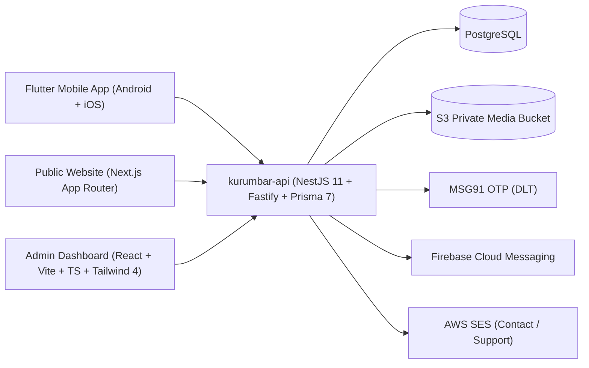

# Kurumbar Platform — Implementation Plan

Source specification: `Kurumbar Website and Mobile App Development` (8-page functional specification).

## 1. Platform Scope

| Surface | Modules & Features |
|---|---|
| **Public Website** (`www.kurumbar.org`) | Home, About Us, Registration, Gallery, Contact, Public Member ID QR Verification (`/verify/:memberId`) |
| **Mobile Application** (Android & iOS) | Latest News/Posts feed, Member Registration & In-App Digital ID Card, Matrimony, Job Portal, Sales Marketplace |
| **Admin Dashboard** | Manage News, User Data Management (add/remove/view details & photos), Matrimony verification queue, Sales moderation & categories, Job Portal moderation & employer/candidate management, Gallery & Contact Enquiries, Audit Logs |

**Explicitly Out of Scope (Phase 1):** Online payments/transactions, shopping cart/checkout, in-app chat/chatbot, AI matching/recommendations, map/GPS-based matching, interview scheduling, delivery/logistics tracking. All member-to-member or member-to-team communication uses phone calls or email.

---

## 2. System Architecture

| Service / App | Stack | Architecture Basis |
|---|---|---|
| `kurumbar-api` | NestJS 11, Fastify 5, Prisma 7, PostgreSQL, Swagger | Genie `fleet-gateway` core standards & modular structure |
| `kurumbar-app` | Flutter, Provider, `go_router`, `http`/`dio`, `flutter_secure_storage`, `flutter_screenutil`, Tamil/English l10n | Genie `the-genie-customer-app` architecture |
| `kurumbar-admin` | React 19, Vite, TypeScript, Redux Toolkit, Axios, Tailwind CSS 4 | Genie `command-center-react-app` state & routing patterns on Vite |
| `kurumbar-web` | Next.js (App Router), TypeScript, Tailwind CSS | Static/SEO-optimized public site + web member registration |

---

## 3. Reusable Genie Core Modules vs. Excluded Modules

### Reused from Genie Architecture
- **Authentication & Sessions:** Mobile OTP auth controller, OTP core service, session/JWT token services, global auth guard with public-route exclusions.
- **OTP & SMS Provider:** Bcrypt-hashed OTP storage, resend window, failure ceiling/lockout, `ACTIVATE_SMS_SERVICE` toggle, MSG91 SMS provider.
- **Object Storage:** Presigned S3 upload URLs with strict MIME allowlist (`image/jpeg`, `image/png`, `image/webp`, `application/pdf`).
- **Notifications & Email:** Firebase Admin push notifications (for published news & approval alerts), AWS SES email dispatch (contact enquiries & support).
- **Observability & Error Handling:** `AppLogger` with PII sanitizer, `traceStore` correlation IDs, `HttpLoggingInterceptor`, `GlobalBadRequestFilter`, `HttpExceptionFilter`, Sentry instrumentation, health check controller, `ShutdownObserver`.
- **Approval & RBAC Patterns:** Role-based access control (`accesscontrol` / `nest-access-control`) and human-auditing approve/reject workflow with audit trails.
- **QR & ID Card Rendering:** `qrcode` library and headless rendering pipeline for digital ID cards.

### Excluded (Not Needed in Phase 1)
- Kafka, gRPC/Protobuf, Elasticsearch/Meilisearch, LiveKit voice/video, Razorpay/Cashfree/payouts, delivery pricing & H3 geo-cells, DigiLocker/Aadhaar QR, AWS Rekognition, Redis (Phase 1 runs on PostgreSQL; Redis can be added later if caching/rate-limit scaling requires it).

---

## 4. Data Model Overview (Prisma)

All models live in the upper section of `prisma/schema.prisma`; all enums live in the lower section. Optional text fields are nullable (never empty strings `""`).

| Model | Purpose & Key Fields |
|---|---|
| `User` | Shared account: `mobile` (unique E.164), `name`, `isMobileVerified`, `role` (`MEMBER`), `status`, `consentAt` |
| `Session` | JWT refresh session metadata, device/FCM token tracking |
| `MemberProfile` | `fatherName`, `maritalStatus`, `childrenMale`, `childrenFemale`, `dob`, `education`, `districtId`, `constituencyId`, `fullAddress`, `kulam`, `kuladeivam`, `professionSector` (`PRIVATE`/`GOVERNMENT`), `jobTitle`, `houseType` (`OWN`/`RENTAL`), `landAvailable`, `landDetails`, `photoKey`, `memberId` (unique), `idCardKey` |
| `MemberIdCounter` | `districtCode`, `genderCode` (`M`/`W`), `lastValue` (transactional row lock prevents duplicate IDs) |
| `District` & `Constituency` | Seeded Tamil Nadu reference master data (38 districts, 234 assembly constituencies) |
| `MatrimonyProfile` | All §4.1–4.3 fields (profileFor, gender, dob, altMobile, maritalStatus, motherTongue, religion, caste, familyStatus, familyType, subCaste, gothram, height, weight, bodyType, disability, zodiac, star, dosham, location, education, employed, occupation, annualIncome, workLocation) + `verificationStatus` (`PENDING`/`VERIFIED`/`REJECTED`), `rejectionReason`, `reviewedBy`/`At` |
| `MatrimonyPhoto` | `profileId`, `s3Key`, `sortOrder`, validation status (max 5 enforced in service & DB) |
| `SalesListing` & `ListingImage` & `SalesCategory` | Seller details, `type` (`PRODUCT`/`SERVICE`), `title`, `description`, `priceType` (`FIXED`/`NEGOTIABLE`/`NONE`), `price`, district/city/address, `stockStatus`, `isActive`, `approvalStatus`, max 5 images |
| `JobPost` & `JobCategory` | `title`, `jobType` (`FULL_TIME`/`PART_TIME`/`CONTRACT`), `categoryId`, `qualification`, `experience`, `salaryMin`/`Max`, `description`, `openings`, `districtId`, `city`, `contactMobile`, `contactEmail`, `approvalStatus` |
| `NewsPost` | Title, body (EN/TA), cover image key, publish status, timestamps |
| `GalleryItem` & `ContactEnquiry` | Public website gallery media and rate-limited contact submissions |
| `AdminUser` & `AuditLog` | `SUPER_ADMIN` / `MODERATOR` accounts and immutable audit trail for every view/edit/approval/deletion of member PII |

---

## 5. Core Business Flows

### 5.1 Unified OTP Authentication & Prerequisite Gate
- Users authenticate once via Mobile Number + OTP (`POST /auth/otp/request`, `POST /auth/otp/verify`) and receive JWT access + refresh tokens.
- Member Registration (`MemberProfile`) must be completed before accessing Matrimony, Sales, or Job Portal actions.

### 5.2 Member Registration, Member ID & In-App Digital ID Card
1. User verifies mobile via OTP, captures a compressed half-size photo (with in-app framing guide), uploads via presigned S3 URL, and submits registration details.
2. Selecting a **District** dynamically filters the **Sattamandra Thogudhi (Constituency)** selector to seats in that district.
3. Inside a serializable/locked PostgreSQL transaction, `MemberIdCounter` increments atomically to generate `TN<DistrictCode><M|W><7Digits>` (e.g., `TN01M0000001`, `TN01W0000001`).
4. Backend generates the in-app **ID Card** (Front: Name, Father's Name, DOB, Member ID, Photo, signed verification QR code; Back: Full Address).
5. The QR code encodes a signed URL (`https://kurumbar.org/verify/<memberId>?sig=...`) rather than raw PII, returning only verified status, name, and photo on scan.

### 5.3 Matrimony
- Four-step registration wizard matching spec §4.1–4.4, up to 5 validated photos.
- Server-side validation enforces legal marriage age (21+ groom, 18+ bride), physical field bounds, and max-5 photo limit.
- New profiles enter `PENDING` status until manually verified by the admin team.
- Verified profiles can browse verified profiles (subject to final visibility rules), with personal phone numbers concealed; contact routes through the Kurumbar team via phone or email.

### 5.4 Sales Marketplace
- Members post product/service listings (up to 5 photos) which enter `PENDING` review.
- Sellers can edit, delete, activate, or deactivate their listings; editing an approved listing resets its status to `PENDING` for re-approval.
- Buyers filter listings by district/category and contact sellers directly via phone call (`tel:`).

### 5.5 Job Portal
- Employers post jobs (`PENDING` until admin approval) with openings, type, qualification, experience, and optional salary range.
- Job seekers browse approved openings by district/category and contact employers directly via phone or email.
- Admin moderates posts and manages employers and candidates.

### 5.6 News, Website & Admin
- Admin publishes/updates/deletes news posts reflected immediately in the mobile app feed, with optional FCM push notifications.
- Admin dashboard provides full moderation queues, category management, user management (add/remove/inspect data & images), and audit logs.

---

## 6. REST API Surface (`/api` prefix, Swagger at `/api/docs`)

- **Auth:** `POST /auth/otp/request`, `POST /auth/otp/verify`, `POST /auth/refresh`, `POST /auth/logout`
- **Master Data:** `GET /geo/districts`, `GET /geo/districts/:id/constituencies`, `GET /categories?type=SALES|JOBS`
- **Media:** `POST /media/presign`
- **Members:** `POST /members`, `GET /members/me`, `PATCH /members/me`, `GET /members/me/id-card`, `GET /verify/:memberId` (public)
- **Matrimony:** `POST/PATCH/GET /matrimony/me`, `GET /matrimony/profiles`
- **Sales:** `POST /sales`, `PATCH/DELETE /sales/:id`, `PATCH /sales/:id/active`, `GET /sales`, `GET /sales/mine`
- **Jobs:** `POST /jobs`, `PATCH/DELETE /jobs/:id`, `GET /jobs`, `GET /jobs/mine`
- **Public Content:** `GET /news`, `GET /gallery`, `POST /contact`
- **Admin (`/admin/*`):** Users CRUD, Members inspection, News CRUD, Matrimony verify/reject, Sales approve/reject/edit/delete, Categories CRUD, Jobs approve/reject/edit/delete, Gallery CRUD, Enquiries, Dashboard stats, Audit logs.

---

## 7. Phased Delivery Plan

| Phase | Scope |
|---|---|
| **Phase 0 — Foundation** | Monorepo setup, green & yellow brand identity, UI/UX Pro Max design system, scaffolding for API, Flutter app, Admin, and Next.js website |
| **Phase 1 — Backend Core** | Port Genie OTP auth, JWT sessions, MSG91 SMS, S3 presign, Prisma core schema & migrations, Tamil Nadu district/constituency seed, Admin RBAC & AuditLog |
| **Phase 2 — Member Registry & ID Card** | Member registration API, atomic Member ID generator, Digital ID card renderer & QR verification, Flutter registration wizard + camera, Web registration |
| **Phase 3 — News & Public Website** | News CRUD + FCM notifications, Gallery, Contact form, Next.js bilingual website (`www.kurumbar.org`) |
| **Phase 4 — Matrimony** | 4-section Matrimony API & Flutter wizard, 5-photo upload, admin manual verification queue, verified profile browsing |
| **Phase 5 — Sales & Job Portal** | Sales & Jobs CRUD, moderation queues, category management, district/category search & direct call/email CTAs |
| **Phase 6 — Admin Polish & QA** | Comprehensive unit/integration tests, responsive & WCAG accessibility audit, security & DPDP compliance review |
| **Phase 7 — Production Release** | Android Play Store & iOS App Store submission, DLT verification check, production DNS & SSL setup |

---

## 8. Key Risks & Mitigations

| Risk | Mitigation |
|---|---|
| **Indian SMS DLT Registration Lead Time** | Initiate client DLT entity, sender header, and OTP template approval in Week 1; develop with `ACTIVATE_SMS_SERVICE=false`. |
| **Concurrent Member ID Collisions** | PostgreSQL row-level locking on `MemberIdCounter` inside transaction + unique constraint on `memberId`. |
| **Sensitive Personal Data (DPDP Act 2023)** | Explicit user consent capture, private S3 bucket with short-lived presigned URLs, PII-masked logging, admin audit logs, account deletion flow. |
| **OTP Cost / Abuse** | Reuse Genie resend cooldowns, failure lockouts, and per-IP rate limiting. |
| **Abusive / Unmoderated Content** | Mandatory admin approval queue for Matrimony, Sales, and Jobs; editing approved posts resets status to `PENDING`. |
| **Usability on Low-End Devices / Older Users** | Bilingual Tamil/English copy, 44px+ touch targets, compressed photo uploads, and step-by-step wizard persistence. |
